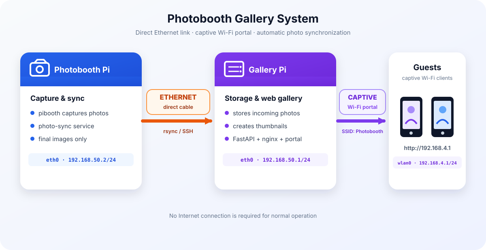

# Photobooth Gallery

Local photo gallery for a photobooth system using two Raspberry Pis.
The photobooth Raspberry Pi automatically sends photos to the gallery Raspberry
Pi, which creates a Wi-Fi access point and displays the photos in a web gallery.

## How it works



The photobooth sends photos over the dedicated Ethernet link. The gallery Pi
stores them, generates thumbnails, and serves them to phones connected to its
Wi-Fi access point.

| Device | Interface | Address | Role |
|---|---|---|---|
| Gallery | `eth0` | `192.168.50.1/24` | Link to the photobooth |
| Gallery | `wlan0` | `192.168.4.1/24` | Wi-Fi access point |
| Photobooth | `eth0` | `192.168.50.2/24` | Link to the gallery |

Photos are transferred one way using SSH and `rsync`. Only image files directly
inside the watched directory are sent; subdirectories are ignored. The gallery
automatically generates thumbnails and display-sized images.

## Contents

- `install-galerie.sh`: installs the Wi-Fi access point, captive portal, nginx,
  and the FastAPI gallery on the gallery Raspberry Pi.
- `install_galery_En.sh`: English version of the gallery installation script.
- `install-photomaton.sh`: configures the Ethernet link and photo
  synchronization service on the photobooth Raspberry Pi.
- `install-photobooth_En.sh`: English version of the photobooth installation
  script.

## Requirements

- Two Raspberry Pis connected directly by Ethernet.
- Raspberry Pi OS Bookworm or another NetworkManager-compatible version.
- A local user with `sudo` privileges on each Pi.
- A photobooth that already produces `.jpg`, `.jpeg`, or `.png` files.
- The scripts must be run with `sudo` from a regular user account, not from a
  root login.

## Installation

Clone the repository or copy the two scripts to both Raspberry Pis:

```bash
git clone https://github.com/Nico31Fr/Photobooth-Galery.git
cd Photobooth-Galery
chmod +x install-galerie.sh install-photomaton.sh
```

### 1. Gallery Raspberry Pi

Run this on the Raspberry Pi that will host the gallery:

```bash
sudo SSID="Photobooth" ./install-galerie.sh
```

For a password-protected Wi-Fi network:

```bash
sudo SSID="Photobooth" WIFI_PASS="choose-a-password" ./install-galerie.sh
```

At the end, `wlan0` becomes an access point and `eth0` receives the fixed
address `192.168.50.1`. An SSH connection using the previous Ethernet
configuration will normally be disconnected. This is expected.

Reconnect through the new Wi-Fi network at `http://192.168.4.1/`, or use SSH:

```bash
ssh <gallery-user>@192.168.4.1
```

The gallery stores received photos in `/srv/galerie/photos`.

### 2. Photobooth Raspberry Pi

Connect the Ethernet cable, then run this on the photobooth Raspberry Pi.
Replace the placeholders with the local gallery account and the directory that
contains the final photos:

```bash
sudo GALERIE_USER="<gallery-user>" \
  PHOTO_DIR="/path/to/photos" \
  ./install-photomaton.sh
```

Optional network parameters can be specified explicitly:

```bash
sudo GALERIE_USER="<gallery-user>" \
  GALERIE_HOST="192.168.50.1" \
  P2P_IP="192.168.50.2/24" \
  PHOTO_DIR="/path/to/photos" \
  ./install-photomaton.sh
```

The script creates a dedicated SSH key at `~/.ssh/id_galerie`. The gallery
user's password is requested once by `ssh-copy-id`; subsequent transfers do not
need a password.

## Usage

1. Connect phones to the Wi-Fi network defined by `SSID`.
2. Open `http://192.168.4.1/` if the captive portal does not open automatically.
3. Take photos with the photobooth. They should appear in the gallery after the
   transfer and thumbnail generation, usually within a few seconds.

The `photo-sync` service synchronizes at startup, when a file is completed, and
at least every 30 seconds. It does not delete files from the gallery.

The gallery is local and normally does not need Internet access. With an open
Wi-Fi network, anyone within range can view the photos. Use `WIFI_PASS` if the
photos must remain private.

## Checks and troubleshooting

On the photobooth Raspberry Pi:

```bash
systemctl is-active photo-sync
journalctl -u photo-sync -f
ip -br addr show eth0
ping -c3 192.168.50.1
cat /etc/photo-sync.conf
```

On the gallery Raspberry Pi:

```bash
systemctl status galerie nginx --no-pager
journalctl -u galerie -n 30 --no-pager
nmcli con show --active
ip -br addr show eth0 wlan0
ls -lt /srv/galerie/photos | head
curl -sI http://192.168.4.1/ | head -1
```

If no photo is synchronized, check that `PHOTO_DIR` exists and that image
files are directly inside that directory. If the service is active but the
gallery is empty, check `journalctl -u galerie` and confirm that files are
present in `/srv/galerie/photos`.

If the captive portal does not open automatically, connect manually to
`http://192.168.4.1/`. HTTPS websites cannot be redirected by a captive portal;
this is expected.

## Uninstallation

The scripts do not provide an automatic uninstall command. To stop the main
services:

```bash
# On the gallery Raspberry Pi
sudo systemctl disable --now galerie nginx
sudo nmcli con delete hotspot
sudo nmcli con delete p2p-photomaton

# On the photobooth Raspberry Pi
sudo systemctl disable --now photo-sync
sudo nmcli con delete p2p-galerie
```

Review the NetworkManager profiles before deleting them if the Raspberry Pis
use another network configuration.

## License

No specific license has been declared yet.
